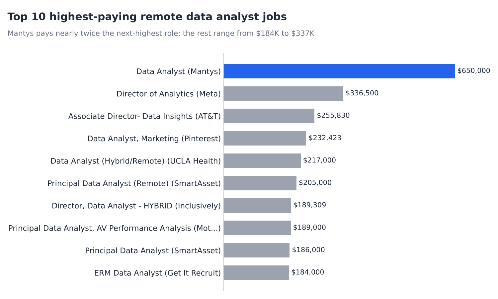
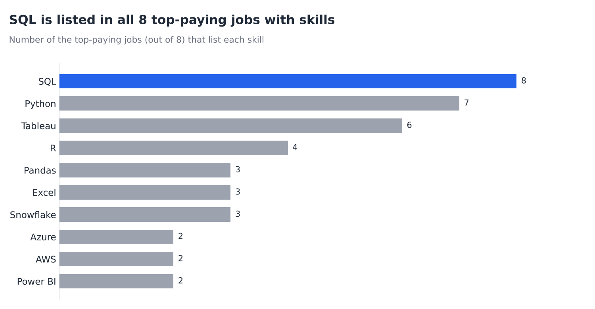
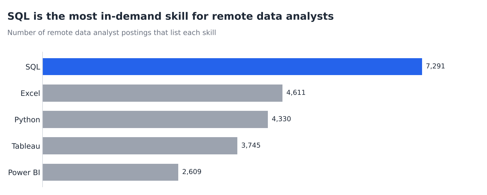
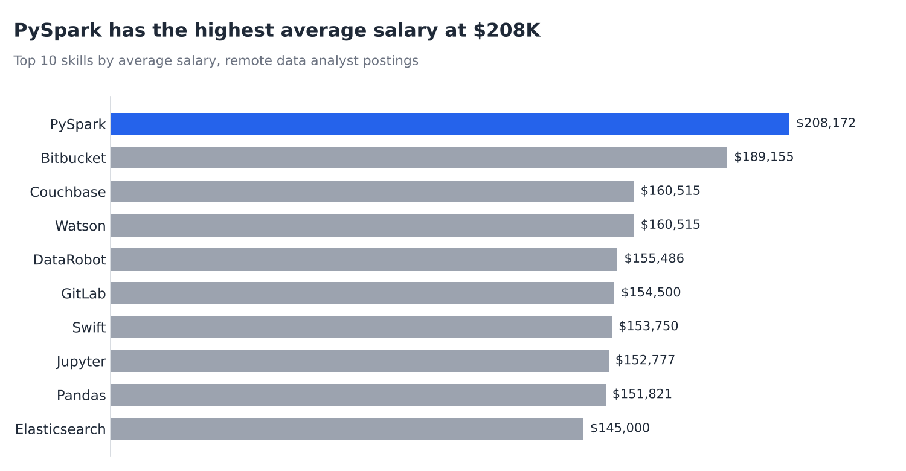
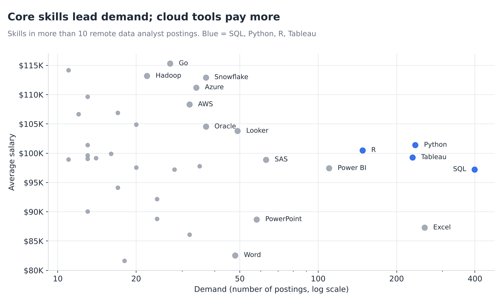

# Data Analyst Job Market Analysis (SQL)

# Introduction

This project explores the 2023 data analyst job market, with a focus on remote roles. It answers five questions: which jobs pay the most, which skills those jobs require, which skills are most in demand, which skills pay the most, and which skills are the best mix of both.

SQL queries are in the [project_sql](project_sql/) folder:

1. [Top-paying jobs](project_sql/1_top_paying_jobs.sql)
2. [Top-paying job skills](project_sql/2_top_paying_job_skills.sql)
3. [Top demanded skills](project_sql/3_top_demanded_skills.sql)
4. [Top-paying skills](project_sql/4_top_paying_skills.sql)
5. [Optimal skills](project_sql/5_optimal_skills.sql)

# Background

I built this project to figure out which skills are worth learning to land a well-paid data analyst job. The dataset contains 2023 job postings with job titles, salaries, locations and required skills.

The questions I answered:

1. What are the top-paying remote data analyst jobs?
2. What skills do those top-paying jobs require?
3. What skills are most in demand for data analysts?
4. Which skills are associated with higher salaries?
5. What are the most optimal skills to learn (high demand and high pay)?

Data comes from Luke Barousse's [SQL Course](https://lukebarousse.com/sql). It's filled with insights on job titles, salaries, locations, and essential skills.

# Tools I used

- **SQL:** the core of the analysis, used to query the database and answer each question.
- **PostgreSQL:** the database management system that holds the job postings data.
- **Visual Studio Code:** for writing and running SQL queries.
- **Python (matplotlib):** for creating the charts.
- **Git & GitHub:** for version control and sharing the project.

# The Analysis

Each query targets one question about the data analyst job market.

### 1. [Top-paying data analyst jobs](project_sql/1_top_paying_jobs.sql)

I filtered data analyst roles by yearly salary and remote location ("Anywhere") to find the 10 highest-paying jobs.

```sql
SELECT
    job_id,
    job_title,
    job_location,
    job_schedule_type,
    salary_year_avg,
    job_posted_date,
    name AS company_name
FROM job_postings_fact
LEFT JOIN company_dim ON job_postings_fact.company_id = company_dim.company_id
WHERE
    job_title_short = 'Data Analyst'
    AND job_location = 'Anywhere'
    AND salary_year_avg IS NOT NULL
ORDER BY salary_year_avg DESC
LIMIT 10;
```


*Top 10 highest-paying remote data analyst jobs*

| Job title | Company | Salary (USD) |
| --- | --- | --- |
| Data Analyst | Mantys | 650,000 |
| Director of Analytics | Meta | 336,500 |
| Associate Director - Data Insights | AT&T | 255,830 |
| Data Analyst, Marketing | Pinterest | 232,423 |
| Data Analyst (Hybrid/Remote) | UCLA Health | 217,000 |
| Principal Data Analyst (Remote) | SmartAsset | 205,000 |
| Director, Data Analyst - Hybrid | Inclusively | 189,309 |
| Principal Data Analyst, AV Performance Analysis | Motional | 189,000 |
| Principal Data Analyst | SmartAsset | 186,000 |
| ERM Data Analyst | Get It Recruit | 184,000 |

**Takeaways:**

- **Wide salary range:** the top 10 roles pay from $184,000 to $650,000.
- **One likely outlier:** Mantys lists $650,000 for a plain "Data Analyst" title, nearly twice the next-highest role. It's probably a data error; without it, the range is $184,000 to $336,500.
- **Varied employers:** the list includes tech (Meta, Pinterest), telecom (AT&T), healthcare (UCLA Health) and finance (SmartAsset).
- **Seniority matters:** most top roles are senior titles such as Director, Principal or Associate Director.

### 2. [Skills for top-paying jobs](project_sql/2_top_paying_job_skills.sql)

I joined the top 10 jobs from the first query with the skills tables to see what those employers ask for.

```sql
WITH top_paying_jobs AS (
    SELECT
        job_id,
        job_title,
        salary_year_avg,
        name AS company_name
    FROM job_postings_fact
    LEFT JOIN company_dim ON job_postings_fact.company_id = company_dim.company_id
    WHERE
        job_title_short = 'Data Analyst'
        AND job_location = 'Anywhere'
        AND salary_year_avg IS NOT NULL
    ORDER BY salary_year_avg DESC
    LIMIT 10
)

SELECT
    top_paying_jobs.*,
    skills
FROM top_paying_jobs
INNER JOIN skills_job_dim ON top_paying_jobs.job_id = skills_job_dim.job_id
INNER JOIN skills_dim ON skills_job_dim.skill_id = skills_dim.skill_id
ORDER BY salary_year_avg DESC;
```


*Skills listed in the top-paying data analyst jobs*

Eight of the 10 jobs listed skills. The most common skills among them:

| Skill | Jobs that list it (of 8) |
| --- | --- |
| SQL | 8 |
| Python | 7 |
| Tableau | 6 |
| R | 4 |
| Excel | 3 |
| Pandas | 3 |
| Snowflake | 3 |

**Takeaways:**

- **SQL is universal:** every top-paying job with listed skills requires it.
- **Python is close behind,** appearing in 7 of 8 postings.
- **Tableau is the leading visualization tool,** listed in 6 of 8.

### 3. [Most in-demand skills for data analysts](project_sql/3_top_demanded_skills.sql)

I counted how often each skill appears across remote data analyst postings.

```sql
SELECT
    skills,
    COUNT(skills_job_dim.job_id) AS demand_count
FROM job_postings_fact
INNER JOIN skills_job_dim ON job_postings_fact.job_id = skills_job_dim.job_id
INNER JOIN skills_dim ON skills_job_dim.skill_id = skills_dim.skill_id
WHERE
    job_title_short = 'Data Analyst'
    AND job_work_from_home = TRUE
GROUP BY skills
ORDER BY demand_count DESC
LIMIT 5;
```


*Top 5 most in-demand skills for remote data analysts*

| Skill | Demand count |
| --- | --- |
| SQL | 7,291 |
| Excel | 4,611 |
| Python | 4,330 |
| Tableau | 3,745 |
| Power BI | 2,609 |

**Takeaways:**

- **SQL and Excel lead,** showing that core data handling and spreadsheet skills remain essential.
- **Programming and visualization tools follow:** Python, Tableau and Power BI round out the top five.

### 4. [Skills based on salary](project_sql/4_top_paying_skills.sql)

I averaged the salaries of remote data analyst postings for each skill to see which ones pay the most.

```sql
SELECT
    skills,
    ROUND(AVG(salary_year_avg), 0) AS avg_salary
FROM job_postings_fact
INNER JOIN skills_job_dim ON job_postings_fact.job_id = skills_job_dim.job_id
INNER JOIN skills_dim ON skills_job_dim.skill_id = skills_dim.skill_id
WHERE
    job_title_short = 'Data Analyst'
    AND salary_year_avg IS NOT NULL
    AND job_work_from_home = TRUE
GROUP BY skills
ORDER BY avg_salary DESC
LIMIT 25;
```


*Top 10 skills by average salary*

Top 10 shown:

| Skill | Avg salary (USD) |
| --- | --- |
| PySpark | 208,172 |
| Bitbucket | 189,155 |
| Couchbase | 160,515 |
| Watson | 160,515 |
| DataRobot | 155,486 |
| GitLab | 154,500 |
| Swift | 153,750 |
| Jupyter | 152,777 |
| Pandas | 151,821 |
| Elasticsearch | 145,000 |

**Takeaways:**

- **Big data and machine learning pay the most:** PySpark, DataRobot, Pandas and Jupyter sit near the top.
- **Engineering tools pay well too:** Bitbucket and GitLab show the value of version control and deployment skills.
- **Small samples inflate the top:** many of these skills appear in only one to three postings, so their averages are less reliable.

### 5. [Most optimal skills to learn](project_sql/5_optimal_skills.sql)

I combined demand and salary into one query to find skills that are both in demand and well paid.

```sql
SELECT
    skills_dim.skill_id,
    skills_dim.skills,
    COUNT(skills_job_dim.job_id) AS demand_count,
    ROUND(AVG(salary_year_avg), 0) AS avg_salary
FROM job_postings_fact
INNER JOIN skills_job_dim ON job_postings_fact.job_id = skills_job_dim.job_id
INNER JOIN skills_dim ON skills_job_dim.skill_id = skills_dim.skill_id
WHERE
    job_title_short = 'Data Analyst'
    AND salary_year_avg IS NOT NULL
    AND job_work_from_home = TRUE
GROUP BY skills_dim.skill_id
HAVING COUNT(skills_job_dim.job_id) > 10
ORDER BY
    avg_salary DESC,
    demand_count DESC;
```


*Demand vs. average salary for skills in more than 10 postings*

All 36 skills with more than 10 postings, sorted by average salary (SAS appears twice in the raw results because of a duplicate `skill_id`, so it's listed once here):

| Skill | Demand count | Avg salary (USD) |
| --- | --- | --- |
| Go | 27 | 115,320 |
| Confluence | 11 | 114,210 |
| Hadoop | 22 | 113,193 |
| Snowflake | 37 | 112,948 |
| Azure | 34 | 111,225 |
| BigQuery | 13 | 109,654 |
| AWS | 32 | 108,317 |
| Java | 17 | 106,906 |
| SSIS | 12 | 106,683 |
| Jira | 20 | 104,918 |
| Oracle | 37 | 104,534 |
| Looker | 49 | 103,795 |
| NoSQL | 13 | 101,414 |
| Python | 236 | 101,397 |
| R | 148 | 100,499 |
| Redshift | 16 | 99,936 |
| Qlik | 13 | 99,631 |
| Tableau | 230 | 99,288 |
| SSRS | 14 | 99,171 |
| Spark | 13 | 99,077 |
| C++ | 11 | 98,958 |
| SAS | 63 | 98,902 |
| SQL Server | 35 | 97,786 |
| JavaScript | 20 | 97,587 |
| Power BI | 110 | 97,431 |
| SQL | 398 | 97,237 |
| Flow | 28 | 97,200 |
| Alteryx | 17 | 94,145 |
| SPSS | 24 | 92,170 |
| Outlook | 13 | 90,077 |
| VBA | 24 | 88,783 |
| PowerPoint | 58 | 88,701 |
| Excel | 256 | 87,288 |
| Sheets | 32 | 86,088 |
| Word | 48 | 82,576 |
| SharePoint | 18 | 81,634 |

**Takeaways:**

- **Core skills have the most demand:** SQL (398), Python (236) and Tableau (230) pay around $97K–$101K.
- **Cloud tools add a premium:** Snowflake, Azure and AWS pay $108K–$113K with 30+ postings each.
- **Office tools are common but pay less:** Excel, PowerPoint and Word sit near the bottom at $83K–$89K.

# What I learned

- **Complex queries:** joining multiple tables and using `WITH` clauses (CTEs) to break queries into steps.
- **Aggregation:** using `GROUP BY` with `COUNT()` and `AVG()` to summarize data.
- **Debugging:** catching typos in table aliases, missing `GROUP BY` columns and mismatched column names.
- **Simplifying queries:** merging two CTEs with the same joins and filters into one query.
- **Data quality:** spotting duplicate skills (SAS, MongoDB and Ruby each appear under two `skill_id`s) and outliers like the $650,000 salary.
- **Analytical thinking:** turning real questions into SQL and recognizing when small sample sizes skew results.

# Conclusions

1. **Top-paying remote data analyst jobs** range from $184,000 to $336,500 (excluding a likely $650,000 outlier), and most are senior roles.
2. **SQL is required by every top-paying job** that lists skills, making it the most important skill to learn.
3. **SQL is also the most in-demand skill,** appearing in 7,291 remote postings.
4. **Specialized skills like PySpark and Bitbucket** have the highest average salaries, though they rest on few postings.
5. **The most optimal skills** are SQL and Python for demand, plus cloud tools like Snowflake, Azure and AWS for higher pay.

This project sharpened my SQL skills and gave me a clear learning path for the data analyst job market: start with SQL and Python, add a BI tool like Tableau, then pick up a cloud platform.